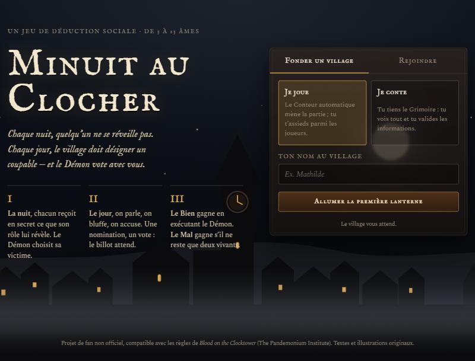

# Minuit au Clocher

Plateforme de jeu en ligne de déduction sociale, compatible avec les règles de *Blood on the Clocktower* (projet de fan non officiel). Elle propose un moteur de règles déterministe, des joueurs IA qui raisonnent, un Conteur automatique ou humain, et une direction artistique gothique originale.



## Lancer

Prérequis : Node.js 20 ou plus.

```powershell
npm install
npm start
```

Puis ouvrir <http://localhost:8787>. `npm start` compile l'interface et lance le serveur.

En développement, avec rechargement à chaud (l'interface est sur <http://localhost:5173>) :

```powershell
npm run dev
```

### IA (facultatif)

Sans configuration, les bots jouent entièrement : ils raisonnent localement et parlent grâce à des gabarits. Pour des répliques plus naturelles, copier `.env.example` en `.env` et renseigner par exemple `AI_PROVIDER=anthropic` et `ANTHROPIC_API_KEY=…`. Les clés restent sur le serveur.

## Tester

```powershell
npm test
```

Les tests couvrent :
- **moteur** : répartition, informations, poison, Ivrogne, morts, nominations, votes, victoires ;
- **isolation des secrets** : 5 à 15 joueurs, plusieurs nuits ;
- **IA** : raisonnement, personnalités, bluffs, erreurs des fournisseurs ;
- **serveur** : WebSocket réel, permissions, reprise de session, persistance après redémarrage ;
- **parties complètes** entre bots.

Pour simuler une partie accélérée entre bots :

```powershell
npm run simulate -- 9 7
```

## Ce qui fonctionne aujourd'hui

- Accueil, création et accès à un salon par code ou lien, reprise automatique après rechargement.
- Lobby : registre, bots avec personnalité au choix, script, durée du débat.
- Script **Trouble Brewing complet** (22 rôles), de 5 à 15 joueurs.
- Partie jouable : actions de nuit, carnet secret, place publique, nominations, plaidoiries, aiguille de vote, votes fantômes, Pourfendeur, exécutions, victoire.
- Grimoire du Conteur humain : rôles, marqueurs (poison, protection, Ivrogne, leurre, Maître), ordre de réveil, décisions limitées aux options légales, historique des votes, journal secret, messages privés, activité des bots.
- Bots : 10 personnalités qui pèsent sur les décisions, raisonnement par mondes possibles, bluffs et fausses infos cohérentes, défense et accusations motivées.
- Interface adaptée au mobile.

## Pas encore fait

- Scripts Bad Moon Rising et Sects & Violets (affichés « pas encore pris en charge »).
- Audio/vidéo, synthèse vocale, conversations privées entre joueurs (présents dans la v1).
- Leçons apprises par les bots d'une partie à l'autre.
- Analyse des vidéos No Rolls Barred (voir `docs/BEHAVIOR_LIBRARY.md`).
- Déploiement public : HTTPS, limitation par adresse IP, expiration des salons, vérification des droits (voir `docs/LEGAL.md`).

## Documentation

- [Audit de la v1](docs/AUDIT.md)
- [Architecture](docs/ARCHITECTURE.md)
- [Règles : officiel, implémentation, propositions](docs/RULES.md)
- [IA et Conteur](docs/AI.md)
- [Bibliothèque comportementale](docs/BEHAVIOR_LIBRARY.md)
- [Droits et licences](docs/LEGAL.md)

La version 1 est conservée dans `legacy/` et sous le tag Git `v1-legacy`.
